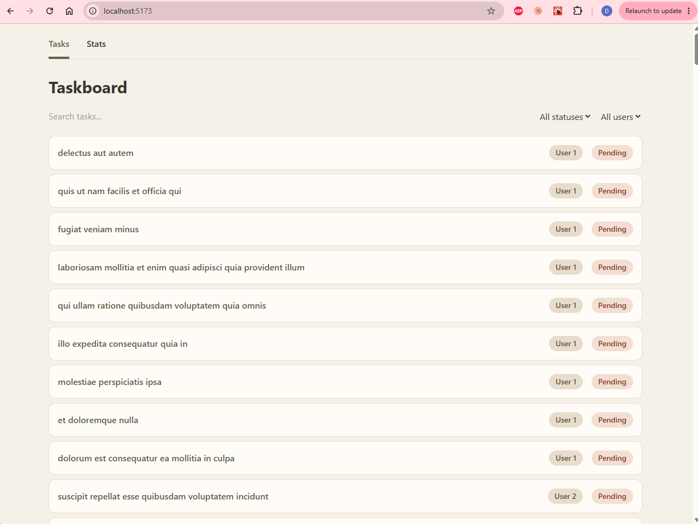
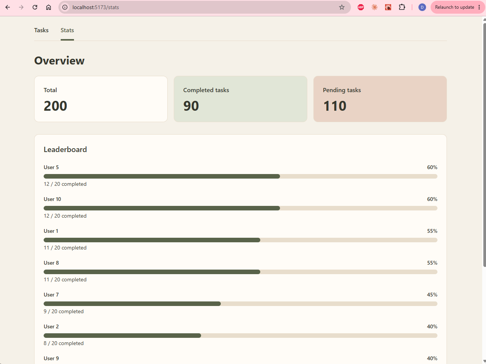
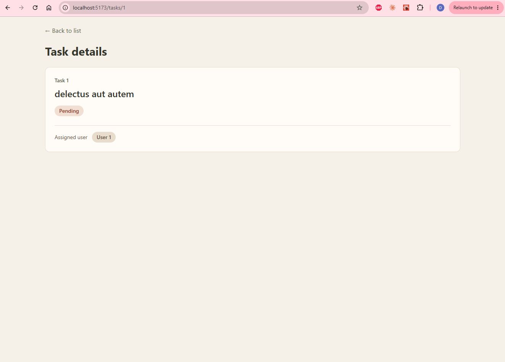

# Mini-project 1 - React Task & Productivity Manager

## Taskboard

A responsive task dashboard for browsing, searching, and filtering tasks from JSONPlaceholder. Users can view individual task details and an overview of task counts and user completion rankings.

## Features

- **Tasks (`/`):** Browse tasks, search titles, and filter by status or assigned user. Pending tasks appear before completed tasks.
- **Task details (`/tasks/:id`):** Read the URL parameter and display the matching task, its completion status, and its assigned user.
- **Stats Overview (`/stats`):** Display total, completed, and pending counts, plus users ranked by task completion percentage.
- **Public API:** [JSONPlaceholder](https://jsonplaceholder.typicode.com/) supplies tasks through `/todos` and individual tasks through `/todos/:id`.
- **TanStack Query:** Handles fetching and caching with `['tasks']` for the list and `['task', id]` for individual tasks.
- **UI states:** Loading messages appear during initial requests; failed requests show an error; empty lists and searches with no matches show helpful messages. Missing task IDs display “Task not found.”
- **Responsive interface:** Tailwind CSS provides mobile and desktop layouts with an earth-tone palette.
- **State and components:** Taskboard owns search and filter state through `useState`, passes values and setters to `TaskFilters`, and uses `PageLayout` for shared page structure.

## Screenshots

### Taskboard



### Stats



### Task details



## Setup

Install Node.js and npm before running the project.

```bash
git clone https://github.com/div-alan/fsdai-week5-mini-project.git
cd fsdai-week5-mini-project
npm install
npm run dev
```

Open the local URL printed in the terminal.


## Tech stack

React, React Router, TanStack Query, Tailwind CSS, Vite.

